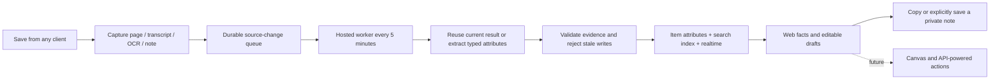

# Stash platform API

The contract for every Stash client — web app, chat mole, menubar widget,
browser extension, iOS. All capture and retrieval intelligence lives server-side
in Supabase edge functions; clients stay thin and platform-independent.

Base URL: `https://uqqsgmwkvslaomzxptnp.supabase.co/functions/v1`

## Auth

Every request sends two headers:

```
Authorization: Bearer <user JWT (session access_token)>
apikey: <anon key>
```

Get a JWT with supabase-js (`auth.signInWithPassword` / OAuth) on any platform,
or the raw REST endpoint `POST /auth/v1/token?grant_type=password`. The item
owner is always derived from the JWT server-side — never sent by the client.

**Google and Apple** use the id-token flow on every platform: get an identity token from the
provider's own SDK (Google Identity Services / GoogleSignIn; Apple JS / AuthenticationServices)
with the SHA-256 hex of a fresh nonce, then `auth.signInWithIdToken({ provider, token, nonce })`
with the raw nonce. Nothing else is needed — no redirect, no client secret. The accepted audiences
are the project's Client IDs (spec `2026-10-11-google-apple-sign-in-design.md` §5.1). Right after
an Apple sign-in, send Apple's authorization code to `POST /apple-token-exchange` (below) so
account deletion can revoke the grant; on first authorization also write the person's name into
the user metadata (`updateUser({ data: { full_name, given_name, family_name } })`). On first Apple
authorization also write the name onto the profile (`display_name`, `first_name`, `last_name`)
when the profile still shows the server fallback — the full contract is in `docs/ui-changes.md`
2026-10-11. Read `user_profiles.handle_confirmed`: when false, show the one-time handle step before
the app.

## Hosted visual accuracy monitoring

`quality-visual` is an infrastructure endpoint, scheduled independently of the
Hermes text auditor every five minutes. The first release queues one real-save
sample and one live canary save per hour. Work, leases, results and reference
versions belong to Stash infrastructure; no local Codex process is required.
This is bounded sampling of **links**, not continuous inspection of every save.
Other object types and embedded-player pixels are explicitly unsupported in this
release and must not be counted as passing checks.

### Displayed-image evidence

The monitor resolves the same initial image routes selected by the web UI:

- A library link card uses its stored `file_path` through public `stash-media`,
  or its remote `file_path` through the image proxy. Repository cards use a
  generated plate and have no cover image to compare.
- A detail panel uses the public storage address or the remote image directly.
  A recognized playable embed replaces that image in the panel. Its canonical
  source follows the same precedence as the web: `attributes.link.canonical_url`,
  then `attributes.enrichment.evidence.canonical_url`, then `url`.
- Card and detail deliveries are separate checks, even when they refer to the
  same original image. A successful publisher image request is not proof that
  Stash's delivery route succeeds.

Each check records the surface, display mode, selected source/delivery URLs,
timestamp, outcome and reason. Retrieved raster evidence includes MIME type,
dimensions, byte length and SHA-256. Approved-reference comparisons also retain
reference ID, immutable version and hash. Byte equality is `exact_match`;
`match`/`mismatch` are model assessments with a recorded method, model and
confidence, not independently verified facts. Low-confidence or insufficient
evidence remains `inconclusive`. `missing_image`, `unavailable` and `unsupported`
are distinct; neither transport failure nor an unchecked image is a success.

Image fetching is bounded and restricted to approved public destinations or the
sample owner's storage prefix. URLs resolve display intent, not permission to
fetch an arbitrary target. Model requests receive fetched image bytes and a
bounded source excerpt, not browser sessions or storage credentials. The monitor
does not certify DOM rendering, crops, animation, or iframe contents. Raster
structure validation alone is not proof that every browser can decode the image.

### Live canary saves and fixed references

Canaries use a dedicated private monitoring account and the real authenticated
`capture` → `add-url` route, including ordinary ownership and entitlement checks.
The durable job ID is reused as `capture_id`, so retrying a lost response does not
create another save. The coordinator waits for enrichment to settle before
comparison; a timeout remains unknown or an operational failure, never a match.
Canary runs are tracked separately from real-save samples and are excluded from
user save-cohort counts. Only registered monitoring-account items and their
unreferenced transient assets are eligible for cleanup.

A canary's source identity and approved reference version are fixed for its run.
An operator approves known-good reference bytes independently of the current
capture. A changed reference hash invalidates the comparison; a fresh capture
cannot promote itself into the baseline. Neither the visual monitor nor Hermes
automatically repairs real saves, replaces references, or publishes playbooks.

### Daily findings

The existing daily email includes a `visual` snapshot alongside text findings:
visual job states; surface-check counts by outcome; real-save findings; live
canary runs and latest results; reference provenance; and explicit coverage
limits. A zero-check window reports accuracy as unknown. Surface checks are not
unique-item counts, and canary results are not a population failure rate.
Detailed findings from other accounts follow the existing report allowlist;
otherwise only aggregate counts appear in email. Reports retain the existing
schedule: prepared after **09:00 America/New_York**, covering the previous local
calendar day, and delivered by the next five-minute dispatcher.

Contracts and tests: `supabase/functions/quality-visual/`,
`supabase/functions/quality-dispatch/report.ts`. No client-side monitoring call or
native rendering change is required.

## Typed publisher facts (beta)

Newly enriched product and place links may include `attributes.object_facts`.
The version-1 product/place shape and source validators live in
`supabase/functions/_shared/objectFacts.ts`. `evidence` records `source_url`,
`observed_at`, `method: "json-ld"`, `extraction_version` and `schema_type`.
Every field is optional unless required by that envelope; omitted is unknown,
not false or free. Display prices as observed at capture and preserve currency.
Facts describe the saved object, separate from `attributes.location` (capture
location). Treat publisher facts as beta evidence, not verified world truth.

Backend capture persists facts. Legacy clients that invoke metadata directly may
use the owner-authenticated `set_item_object_facts` RPC with the exact saved URL,
previous facts (or JSON null), and validated facts. It changes only that leaf and
returns false on a stale source, concurrent edit or protected field. Preserve
unknown attribute keys; do not overwrite the whole blob.

## Object intelligence (beta)

`attributes.object_intelligence` is an additive, server-generated version-1 envelope.
Storage type stays the same: a TikTok is still a `link`, while
`interpretation.kind` may be `recipe` or `travel`. Clients receive it through the
existing item reads and realtime updates. Preserve this leaf when changing other
attributes. The authoritative TypeScript/schema contract is
`supabase/functions/_shared/objectIntelligence.ts`.

- **Interpretation:** semantic kind, short summary, and topics. These are model
  interpretations, not independently verified facts.
- **Facts:** optional creator and one typed group: recipe, travel, product, place,
  paper, book, or event. Each value has `evidence_ids` linking to exact quotations
  in captured text or validated publisher facts. Omitted means unknown. Quotation
  validation establishes traceability, not guaranteed attribution or correctness.
- **Evidence:** source block IDs (`page_body`, `content`, `publisher_facts`,
  `creator_metadata`), quotations, and an envelope source fingerprint. Generated
  descriptions/summaries, user annotations on other objects, and visual guesses
  are excluded. Image facts need OCR; an image's appearance alone is insufficient
  for this first version.
  The model selects numbered captured passages; the server constructs the
  quotations. Formatting whitespace may differ in a proposed value, but stored
  values resolve back to the original source span. Word or attribution changes
  remain invalid. Diagnostics record closed rejection codes, never source text.
- **Capabilities:** a closed catalog of proposed interactions, with `id`,
  `status`, `effect`, `prerequisites`, and `requires_confirmation`. `source_ready`
  means enough captured facts to draft an artifact, not an installed tool or an
  executed action. `needs_lookup` requires a subsequent source/API lookup;
  `needs_more_content` requires additional evidence or user details. External
  writes (grocery orders, calendar changes) require explicit confirmation.

Recipes can expose ingredients, steps, servings and duration; travel can expose
destinations, mentioned places, stays and duration; products can expose identity,
brand, color, materials, variant and an observed publisher price. A packing list
or itinerary is a proposed derivative, never fabricated source content. Travel
mentions do not mean visits or current location; product saves do not mean ownership.
`processed_at` is extraction time, not a price freshness check. Product price and
currency require validated `object_facts` evidence; its `evidence.observed_at`
remains the capture timestamp. Price comparison needs new matching-variant offers.

A private Supabase worker runs every five minutes, after a two-minute source
settling delay, independently of basic-card repair. Source changes requeue work;
an unchanged source hash reuses a valid result. The initial budget is two model
calls per run, 24 per UTC hour, and 200 per UTC day (three attempts per source).
Backlogs can delay completion. The initial backfill covers the latest 100 items;
new saves and source updates enter automatically across all clients. The worker
honors `enrichment.protected_fields.object_intelligence`, uses compare-and-swap
to reject stale writes, and preserves unrelated attributes. Failures retain prior
data; consumers must validate the source fingerprint before using old results.
Current source-bound facts and semantic kind enter search; capability names and
uncreated artifacts do not.

The web detail panel exposes current facts and the first source-backed drafts
through `object-interactions` below. The canvas, API lookups, ordering, bookings,
and other external actions remain subsequent features.



### Object interactions (beta)

`POST /functions/v1/object-interactions` accepts an authenticated user's session
JWT and JSON (maximum 8 KiB). It checks item ownership, including for public
items; agent tokens and service-role credentials are not alternate user access.
Responses are private and `Cache-Control: no-store`.

- **Inspect:** `{ "operation": "inspect", "item_id": "<uuid>" }` returns
  `{ "status": "ready", "intelligence": <validated ObjectIntelligence> }`, or
  `{ "status": "pending" | "unavailable" }`. It revalidates the stored envelope
  against the current source fingerprint. Only queued/processing work with usable
  evidence is pending. Opening a panel does not enqueue extraction or call a model.
- **Draft:** `{ "operation": "draft", "item_id": "<uuid>", "action":
  "shopping_list" | "recipe_card" | "itinerary", "source_fingerprint": "<64-hex>" }`.
  Requires a current envelope and a `source_ready` draft capability with no missing
  prerequisites, plus the existing capture/Ask entitlement. Returns `{ "draft":
  { "version": 1, "action", "title", "content", "source_item_id",
  "source_fingerprint", "created_at", "evidence_ids": [], "notices": [] } }`.
  Drafts are assembled from captured facts without another model call. Ingredient
  quantities and recipe steps remain as captured. An itinerary is a starter outline
  of mentioned places/stays in source order; it has no invented route, hours,
  bookings, or assignment to days. Missing facts are not filled in.
- **Errors:** `400 invalid_request`, `401 unauthorized`, `403 session_required`
  (or the standard `subscription_required` entitlement response), `404 item_not_found`,
  `409 source_changed | intelligence_unavailable | action_unavailable`,
  `413 request_too_large`, `415 json_required`, or `503 object_interactions_unavailable`.
  Method errors are `405`; preflight is `204`. No private source text appears in errors.

Clients let the person review/edit the draft before copying or saving. **Save**
calls the existing `add-note` endpoint with their accepted title/content,
`is_public: false`, and optional provenance:

```json
{
  "derived_from": {
    "version": 1,
    "item_id": "<source item uuid>",
    "source_fingerprint": "<source fingerprint used for this draft>",
    "action": "shopping_list",
    "draft_version": 1,
    "created_at": "<draft generation timestamp>",
    "edited": true
  }
}
```

`derived_from` is user-supplied provenance, not proof of independent verification.
Preserve it with other unknown attribute leaves. Saving creates an ordinary private
note through the shared capture pipeline; the source object remains unchanged.
The web capture client checks the current session against the intended owner and
pins that session token to the request, so an account switch during preparation
cannot save a private draft into the newly selected account.
A previously opened draft may be retained after a source update, but the UI must
identify it as based on an earlier source and must not label it current. External
orders, calendar writes and similar actions are not performed by this endpoint.

## Places (`attributes.place`)

A saved address that stands for a place — an Apple Maps or Google Maps link
(short links included), a listing page whose structured data carries
coordinates, or a picture whose own text carries a street address confirmed by
the geocoder (`provider.kind: "ocr"`) — gets `attributes.place` (v1, `_shared/place.ts`): name, address,
coordinates, time zone, phone, website, menu link, weekly hours, rating, price
level, category, the provider and its resolved address, the rendered map, and
evidence. The capture pipeline writes it (`set_item_place`, a leaf
compare-and-swap; a client never does) and, when the map provider is
configured, renders the map as the save's picture (`file_path`). Clients render
the location section from it; "open now" is only honest when `timezone` is
present. Unknown keys must be preserved. See `docs/ui-changes.md` 2026-10-10.

## Capture

**Entitlement (server-enforced since 2026-09-07).** Every capture endpoint
below, and Ask, returns
`403 { "error": "subscription_required", "message": "…", "status": "<stripe status>" }`
when the account's Stripe subscription is lapsed (`paused`, `canceled`,
`unpaid`, `past_due`, `incomplete`, `incomplete_expired`). Trialing, active,
and accounts with no subscription yet pass. Show `message`, link to
`gostash.it/settings`, and do not retry.

Every capture endpoint (`add-url`, `add-note`, `add-file`) accepts an optional
`attributes` object in the request body — structured facts about the item
(location, link metadata, media info; shapes defined in
`src/types/itemAttributes.ts`) that aren't its content. It's stored whole-blob
on `items.attributes` (jsonb): omit it, send `{}`, or send anything that
isn't a plain object (e.g. an array) and it's treated as `{}` — never a 500.
`add-url` additionally guarantees `attributes.link.flavor` on every saved
link: a caller-supplied flavor wins, otherwise the server classifies one from
the URL alone (`article` / `video` / `repo` / `book` / `social` / `generic`).

Every capture endpoint also accepts an optional top-level `remind_at`
(ISO-8601 timestamp): "bring this back to me then". It must parse and be no
older than one hour before now; anything else is ignored — the item still
saves with `remind_at: null` and a warning is logged. Never a 4xx. The
returned item includes `remind_at`, `reminder_cleared_at`,
`reminder_notified_at`. See **Reminders** below.

### `POST /add-url` — save a link

```json
{ "url": "https://…", "content": "optional note about it", "is_public": false }
```

Returns `{ success, item }` fast (title/description from a quick fetch, bounded
at 8 s for the page and 12 s for its image; YouTube and TikTok resolve from
oEmbed alone). Everything else continues server-side after the response: deep
metadata with the blocked-site rescue cascade (crawler UA → Jina Reader →
Wayback → URL inference), preview image storage, full-page scrape into
`page_body` — for YouTube, TikTok and Instagram Reels that is the transcript
(`attributes.enrichment.evidence.transcript = true`), with a recording-style
`summary` — and embeddings. Every link gets this, whichever client saved it;
a TikTok with nothing to transcribe still settles `complete` with its caption.
Clients never wait on enrichment — realtime (below) delivers the upgrades.

`tags: …` at the end of `content` becomes item tags.

### `POST /add-note` — save a text note

```json
{ "content": "the note", "title": "optional", "is_public": false }
```

Returns `{ success, note }` immediately with a derived title (the first line,
at most 60 characters); AI title + description + re-embed land asynchronously.
`content` may be plain text or a Novel/TipTap JSON document (what the web and
iOS editors store): every derived field is built from its plain text, never
the JSON scaffolding. A note whose entire content is one
HTTP(S) URL keeps its literal or user-provided title and skips AI title/description
generation: an opaque URL is not evidence about the linked page. Use `add-url`
for link enrichment (or `capture`, which normalizes this share-sheet case).
A note that holds pictures (`image` nodes with web addresses) has them described
after the response by `analyze-note-images` (below): what each shows and says
lands in `attributes.note_images`, feeds the AI title/description along with the
words, and joins the index. A note with no words (a picture alone) starts with an
empty title until the AI title lands — never the JSON itself.

### `POST /analyze-note-images` — describe the pictures inside a note

```json
{ "itemId": "<uuid>" }
```

Service calls or the owner's JWT. Reads the note (`items.content`), describes each
picture it holds that isn't described yet (`analyze-image`, no writes), drops
descriptions of pictures that left the note, and writes
`attributes.note_images = { version: 1, images: [{ src, description, text?, analyzed_at }] }`
through a compare-and-swap; then re-indexes the save. Answers
`{ success: true, changed, described, pending }` (`pending`: pictures left for the
next call — at most 8 are described per call) or `{ success: false, reason:
"item_changed" }` when the leaf moved meanwhile (whoever moved it re-indexes). A
note whose pictures are all known costs nothing: call it after every save of a
note with pictures. Clients read the leaf; never write it.

### `POST /add-file` — save an uploaded file

Upload to Storage first (`stash-media/<userId>/<name>.<ext>`), then:

```json
{ "file_path": "<userId>/…", "mime_type": "image/png", "file_size": 1234,
  "content": "optional note", "title": "optional", "is_public": false }
```

Returns `{ success, item }` fast. Type derives from MIME (image/audio/video,
else document). Enrichment continues server-side after the response: vision
description + OCR for images; for audio/video the `transcribe-audio` job
below (transcript into `page_body`, blurb, summary, AI title, media kind);
embeddings for all. Documents branch by exact MIME: `application/
pdf` gets quick summary + full text extraction into `page_body`; Office Open
XML (`.pptx`/`.docx`/`.xlsx`) gets text extraction via the same page_body/
summary/description contract; anything else settles immediately with an AI
description (`summary` mirrors `description` — no `page_body`). Realtime
delivers the upgrades. `file_path` must sit inside the caller's own folder
(403 otherwise). Audio/video keep `attributes.enrichment.status = "pending"`
until the transcription job finishes; the status then settles to `complete`
(`attributes.media.transcript.status = "done"`) or `partial` (`"failed"`) in
the row itself. Send the original file name as `title` and as
`attributes.media.file_name`; the storage object name is never kept as one.
Documents also get a picture after the response, before extraction:
`attributes.media.preview = { file_path, source, rendered_at }` — page 1 of a PDF
(`source: "pdf-page-1"`, drawn by the `api/document-preview` renderer) or the
preview an Office app saved inside a `.pptx`/`.docx`/`.xlsx` package
(`"ooxml-thumbnail"`; absent from some exports, then no preview). `file_path` is
`<userId>/previews/doc_<itemId>.png|jpg` in `stash-media`; show it as the card's
picture, the drawn page otherwise.

### `POST /capture` — idempotent capture (iOS)

One entry point that wraps the three endpoints above and makes every capture
safe to retry. The client generates a `capture_id` (UUID) once per capture and
sends the same id on every attempt, from any process, at any time; the server
never creates a second item for it. **iOS routes every capture through
`capture`** (its Outbox entry id is the `capture_id`, so foreground sends,
background transfers and later drains can all retry blindly). **The web
composer, the browser extension and macOS call `add-*` directly** (since
2026-10-10 the web inserts nothing itself), and `capture` forwards to the same
endpoints with the caller's own JWT, so enrichment, paywall and every other
server behavior are identical for every client.

Standard auth headers. The body is either `application/json` (the meta object)
or `multipart/form-data` with a `meta` part (the JSON string) and a `file` part
(the bytes). Meta:

```json
{ "capture_id": "1b9d6bcd-bbfd-4b2d-9b5d-ab8dfbbd4bed", "kind": "note | url | file",
  "content": "optional", "title": "optional (note/file; ignored for url)",
  "url": "required for url", "is_public": false,
  "attributes": { }, "remind_at": "ISO-8601",
  "mime_type": "required for file", "file_name": "IMG_0042.jpg", "file_size": 1234,
  "file_path": "<uid>/… — file kind without a file part only" }
```

- `capture_id` is required and must be a UUID. Case doesn't matter (it's
  normalized to lowercase), but always send the same id.
- `note` needs non-blank `content`. `url` needs a parseable `url`. `file`
  needs `mime_type` plus exactly one of a multipart `file` part or a
  `file_path` inside the caller's own folder (`<uid>/…`, no empty/`..` segments).
- A `note` containing only one complete HTTP(S) URL is normalized to `url`
  before dispatch, so older share extensions that send YouTube links as plain
  text use the same enrichment as web/extension saves. Surrounding whitespace
  is trimmed; the URL's query and fragment are preserved. The URL is not also
  stored as note content. Prose, multiple links, other schemes and ambiguous
  or credential-bearing strings remain notes. The same `capture_id`, privacy,
  attributes and reminder are retained; an already-completed receipt still
  returns its existing item, without creating or rewriting anything.
- `attributes` and `remind_at` are forwarded as-is and follow the `add-*`
  rules above. A non-object `attributes`, a non-string `remind_at`, or a bad
  `file_size` is dropped with a logged warning. Metadata never causes a 4xx, and
  `attributes: {}` is never forwarded.
- Forwarded bodies: url → `{url, content?, is_public, attributes?, remind_at?}`;
  note → `{content, title?, is_public, attributes?, remind_at?}`; file →
  `{file_path, mime_type, file_size?, content?, title?, is_public, attributes?, remind_at?}`.
  `file_name` only picks the storage extension. The server doesn't turn it into a
  title, so keep the original name in `attributes.media.file_name`.
- The meta is capped at **1 MiB**: the whole body of a JSON request, or the
  `meta` part of a multipart one. Anything larger gets
  `413 { "error": "meta_too_large", "max_bytes": 1048576 }`. That means the
  request itself is too big (usually an enormous note), so don't switch to two-step.

**Files: one-shot or two-step.** A file of up to **45 MiB (47,185,920 bytes)**
goes in ONE multipart request. The server stores it at
`stash-media/<uid>/<capture_id>.<ext>` (upsert, so a retry overwrites instead of
piling up), with the object's content type set to `mime_type` whatever the
part header says. `<ext>` comes from `file_name`'s extension, else from a MIME
map, else `bin`. The server then calls `add-file`, and `file_size` defaults to
the uploaded byte count. Put `meta` first. The `file` part **must** carry a
`filename` in its `Content-Disposition` (any name), because a part without one
is read as text and refused with 400. A multipart request whose
`Content-Length` exceeds 46 MiB (the file limit plus 1 MiB for `meta` and
boundaries) gets `413` without being parsed. Larger files use **two steps**:
upload to Storage yourself at the same deterministic path
(`POST /storage/v1/object/stash-media/<uid>/<capture_id>.<ext>` with
`x-upsert: true`), then send JSON meta with that `file_path`. Measured
2026-09-27: 45 MiB one-shot → 200 in ~16 s end-to-end on a ~24 Mbps uplink
(~2.7 s in-function). The gateway buffers the whole request before the function
runs, and Supabase caps edge-function requests at 150 s, so on a slow uplink a
large file is safer in two steps.

**Per-file cap: 100 MiB (104,857,600 bytes), every kind** (since 2026-10-07;
images and documents were 20 MB). Storage's project upload limit enforces it on
every upload path (one-shot, two-step, `add-file` callers): a bigger object is
refused with HTTP 400 and `{"statusCode":"413","error":"Payload too large",
"message":"The object exceeded the maximum allowed size","code":"EntityTooLarge"}`.
Don't retry it. Clients check before sending (web `MAX_*_SIZE_MB` in
`src/services/imageUpload/MediaUploadTypes.ts`, iOS `CaptureAttachment.byteLimit`).
Saving is not reading: `extract-pdf-text` hands the PDF to OpenAI, which refuses
file inputs of 50 MB or more, and `extract-office-text` refuses anything over 40 MiB.
Such a file saves with no `summary` or `page_body` and `attributes.enrichment.status`
settles `partial`.

**Idempotency** (`capture_receipts`, one row per user + `capture_id`, owner RLS):

| receipt state when a request arrives | result |
|---|---|
| none | reserve (`pending`), capture, then mark `done` with the item id |
| `done` | `200 { item, duplicate: true }`. `item` is the row as it is now (`select *`), or `null` if the user deleted it. Nothing new is created |
| `pending`, touched < 120 s ago | `409 { "error": "capture_in_progress" }`. A live attempt owns it and re-stamps it every 30 s while it waits on `add-*` |
| `pending`, untouched ≥ 120 s | that attempt stalled, so this one takes it over (compare-and-set, under a fresh `attempt_id`) and proceeds |

**Fencing.** Every reservation and takeover stamps the receipt with a fresh
`attempt_id`. That attempt's later receipt writes (heartbeat, done, release)
are filtered by it. If a stalled attempt resumes after being taken over, its
writes match nothing, so it can't overwrite or delete its successor's receipt.
If it finishes anyway, the item it created is a duplicate: it deletes that item
(as the user) and answers `409 capture_in_progress`. The client's next retry
then gets the successor's result.

If the downstream call (or the multipart Storage upload) fails, the attempt
deletes its own receipt (with bounded retry), so a retry starts fresh. When
`add-*` answers non-2xx, the server also removes the one-shot object it
uploaded. It does that only after proving it still owns the receipt, because
the path is shared with any successor. A two-step object is the client's and
stays put. The first response's `item` is exactly what `add-*` returned
(normalized from `item` / `note`; `add-url` adds `metadata` + `previewImagePath`).
A duplicate's `item` is the plain row.

| status | body | meaning / client action |
|---|---|---|
| 200 | `{ "item": {…}, "duplicate": false }` | created now |
| 200 | `{ "item": {…} \| null, "duplicate": true }` | already captured. Treat as success |
| 400 | `{ "error": "invalid_request", "message": "…" }` | bad Content-Type, JSON, multipart, or meta. Don't retry unchanged |
| 401 | gateway `{ "code": "UNAUTHORIZED_…", "message" }` or `{ "error": "Invalid or expired token" }` | refresh the session, then retry |
| 403 | `{ "error": "Agent tokens are only accepted by the MCP endpoint" }` | agent (MCP) token |
| 405 | `{ "error": "Method not allowed" }` | POST only |
| 409 | `{ "error": "capture_in_progress" }` | another attempt with this id is live, or this one was superseded and removed its duplicate. Retry later. Not a failure (don't count an attempt) |
| 413 | `{ "error": "file_too_large", "max_bytes": 47185920 }` | switch to two-step |
| 413 | `{ "error": "meta_too_large", "max_bytes": 1048576 }` | the meta itself is too big. Don't retry unchanged |
| 500 | `{ "error": "receipt_failed", "message" }` · `{ "error": "Internal server error" }` | transient, retry |
| 502 | `{ "error": "storage_upload_failed" \| "downstream_unreachable", "message" }` | transient, retry |
| any other | the `add-*` endpoint's status and body, **verbatim** | e.g. a lapsed account: `403 {"error":"subscription_required","message":"…","status":"paused"}` from `add-note` (and from `add-url`/`add-file` since 2026-09-29, below) |

Known gateway quirk (measured 2026-09-27): `add-note` returns its
`subscription_required` 403 before reading the request body. For bodies larger
than about 0.5 MiB, Supabase's gateway then holds the request for ~160 s and
answers `504` instead of the 403. Up to 512 KiB answered promptly; 900 KiB and
1 MiB stalled. This hits direct `add-note` callers too, and the fix belongs in
`add-note`. Through `capture`, only a lapsed account's very large note sees it,
as a 504 (transient).

**Paywall on every capture kind (production since the 2026-09-29 redeploy).**
`add-url` and `add-file` now refuse a lapsed account exactly like `add-note`:
`403 {"error":"subscription_required","message":"…","status":"<stripe status>"}`
(one shared server gate; a blocking Stripe status — `past_due`, `unpaid`,
`canceled`, `incomplete`, `incomplete_expired`, `paused` — is refused, anything
else passes). `capture` forwards it verbatim, so a lapsed account gets that 403
for notes, links and files alike; iOS parks the Outbox entry until the
entitlement returns. `chat-with-all-content` (see Ask) refuses a lapsed account
with the same 403 before streaming. Before 2026-09-29 only `add-note` did.

### `POST /transcribe-audio` — transcription job for audio/video items

```json
{ "itemId": "<uuid>" }
```

Returns `202 { accepted: true, itemId }` at once (owner JWT or service role;
`add-file` starts it for you, so most clients never call it). The job splits
files over 24 MiB without re-encoding (m4a / mp4 / mov; other containers over
the cap fail with `unsupported_container`), transcribes ≤ 20-minute chunks
with OpenAI, and writes `page_body` progressively, then `description`,
`summary`, an AI title when the title is still filename-shaped,
`attributes.media.kind`, embeddings, and `attributes.media.transcript`
(`status: pending | processing | done | failed`, `chunks_done` /
`chunks_total`, `attempts`, `error`). A pg_cron sweep (`{ "sweep": true }`
with `x-cron-secret`, every 10 minutes) resumes stalled jobs and retries
failures up to 3 attempts. Preview mode `{ "audioUrl", "fileName" }` (a
`stash-media` URL, ≤ 24 MiB) still returns `{ transcription, description }`
synchronously; larger files return `{ deferred: true }`.

## Ask

### `POST /chat-with-all-content` — streaming Q&A over the user's stash

```json
{ "message": "…", "conversationHistory": [{ "role": "user"|"assistant", "content": "…" }] }
```

Responds with Server-Sent Events:

```
data: {"delta":"token"}          ← repeatedly
data: {"status":"searching","query":"…"}   ← optional, while a tool runs
data: {"status":"browsing"}                ← optional (2026-08-30: catalog scan)
data: {"status":"reading"}                 ← optional
data: {"done":true,"sources":[{"id","title","type","url","n"}]}
```

Retrieval is **agentic**: the model drives search itself through internal
tools (`search_stash` — hybrid pgvector + full-text, RRF-fused, with
type/date/tag filters; `get_item` — full notes/summary/captured text), so it
rewrites queries from conversation context, searches more than once for
multi-part questions, and reads items in full before quoting them. `status`
frames are informational — clients may render a "searching…" indicator or
ignore unknown keys entirely (every frame is valid JSON). Sources are the
items the answer cites (fallback: items it read in full). History is capped
server-side at 10 turns.

Citations in the answer text: item titles appear as markdown links targeting
their citation number (`[Title](#3)`), bare `[3]` markers otherwise. Each
sources entry carries that number as `n` — at stream end, clients rewrite
`(#n)` targets into durable item links (`(#item=<uuid>)`), persist the baked
text, and render those links as open-this-card actions. Show a bottom sources
row only for entries not already linked inline (reference:
`src/utils/chatCitations.ts`).

Sessions: conversations are time-gap sessions — a client convention. Pick the
user's latest conversation by `last_message_at`; continue it if the last
message is under 3 hours old, otherwise insert a new `conversations` row
(title null; auto-title it from the first question via `generate-title`).
Send only the current session's messages as `conversationHistory`. A DB
trigger maintains `last_message_at`; `list_conversations()` (SECURITY
INVOKER, RLS-scoped) returns the history list with counts and previews.

### `POST /search-items` — direct search (no LLM answer)

```json
{ "query": "…", "types": ["link"], "tags": ["…"], "after": "ISO", "before": "ISO", "limit": 20 }
```

All fields optional. With `query`: hybrid relevance-ranked search (one result
per item, `snippet` = best matching chunk). Without: newest-first listing
under the same filters. Returns
`{ "results": [{ id, title, type, url, created_at, description, notes, snippet, score }] }`.
`notes` (2026-09-14) is the user's own note on the item as plain text (Novel
JSON and HTML rendered to words, ≤280 chars, `null` when empty) — always
present alongside `snippet` because on long links the best-matching chunk is
usually page body and would hide the note. Ranking also boosts items whose
note matches the query (`hybrid_search_content` v4, `notes_weight` 1.5).
This is the canonical search surface — library search boxes, future MCP
tools, and Siri/Shortcuts should all call it rather than hitting the DB.

## Agents (MCP)

Remote MCP server (Streamable HTTP, JSON responses, stateless):
`https://www.gostash.it/mcp` (a Vercel rewrite to the `mcp` edge function).
Read-only. Spec: `docs/superpowers/specs/2026-09-05-mcp-server-design.md`.

**Auth** is OAuth 2.1 through Supabase Auth's OAuth server — not the session
JWT used everywhere else. Unauthenticated requests get
`401` + `WWW-Authenticate: Bearer resource_metadata="https://www.gostash.it/mcp/.well-known/oauth-protected-resource", scope="email"`;
clients discover the authorization server
(`https://uqqsgmwkvslaomzxptnp.supabase.co/auth/v1`), register dynamically,
and send the user to `https://www.gostash.it/oauth/consent` to approve. The
consent page records an `agent_grants` row; the server refuses tokens whose
client has no active row. Session JWTs are refused on `/mcp`; agent tokens
(JWTs carrying a `client_id` claim) are refused on every other endpoint and
get zero rows through PostgREST/Storage (restrictive RLS) — agents receive
answers, never copies.

**Tools** (all read-only, annotated `readOnlyHint: true`): `search_stash`
(same request/response shape as `POST /search-items`, plus a readable text
rendering) and `get_item` (`{ id }` → notes, description, summary, captured
text capped at 12k chars, `attributes.link.flavor`,
`attributes.location.label`); plus ChatGPT's required `search`
(`{ query }` → `{ results: [{ id, title, url }] }`) and `fetch`
(`{ id }` → `{ id, title, text, url, metadata }`) — aliases over the same code,
returned as `structuredContent` and as a JSON string in the text item. Every
call is logged to `agent_access_log` (Settings → Connected agents → Activity)
and rate-limited per grant (60/min, 2,000/day → `isError` result).

**Discovery:** protected-resource metadata at
`/.well-known/oauth-protected-resource[/mcp]` and a server card at
`/.well-known/mcp-server-card` (site root, static) and under
`/mcp/.well-known/…` (function). Registry entry: `mcp/server.json`
(`it.gostash/stash`). Directory runbook: `docs/mcp/DIRECTORIES.md`.
Protocol versions: `2025-11-25`, `2025-06-18`, `2025-03-26`, `2024-11-05`.

**Client contracts** (any surface adding a "Connected agents" screen):
active grants = `agent_grants` where `revoked_at is null` (owner RLS);
activity = last 50 `agent_access_log` rows, rendered per
`src/utils/agentActivity.ts`; revoke = `DELETE /auth/v1/user/oauth/grants?client_id=…`
(session JWT) **then** set `agent_grants.revoked_at`. Item deep link:
`https://www.gostash.it/home#item=<uuid>` opens that card in the web library.

## Account deletion

`POST /functions/v1/delete-account` — no body. Standard auth headers; the
target account is always the JWT's owner, and agent (MCP) tokens are refused
with `403`. Irreversible, so clients gate it behind an explicit
type-to-confirm step (web: type `DELETE`).

Server order, chosen so that a failure before the auth deletion leaves the
account intact and the call can simply be retried, and so that once the auth
user is gone the answer is always `deleted: true`:

1. Sign in with Apple, staging (2026-10-12) — first, before anything
   destructive: every refresh token `apple-token-exchange` stored for the user
   is copied into `apple_revocations`, a queue with no foreign key to
   `auth.users` so it outlives the account. If the tokens cannot be read or
   copied the call stops here with `503` and **nothing has been touched** — no
   subscription cancelled, no file removed.
2. Stripe — every live subscription on the customer(s) with the user's email
   is canceled (customer record kept for invoice history, tagged
   `stash_account_deleted_at`).
3. Storage — every object under `stash-media/<user_id>/` is removed.
4. `auth.admin.deleteUser` — DB cascades take items, embeddings, tags,
   conversations, messages, phone number, profile, agent grants, feedback,
   logs, the stored Apple tokens and all `auth.*` rows (migrations
   `20260907120000`, `20261011150000`); the `apple_revocations` rows
   deliberately survive (`20261012210000`). A failure in steps 2–4 answers
   `500` with the account intact; the staged rows stay `pending` but are never
   acted on while the account exists (see the sweep below), and the next call
   re-stages them.
5. Sign in with Apple, revocation — only now, with the account gone, each staged
   token is revoked at Apple (each call gives up after 8 s): a 2xx is `revoked`;
   Apple's `400 invalid_grant` (its ErrorResponse: "the authorization grant or
   refresh token is invalid … invalid refresh token" — nothing left to revoke)
   is `invalid`; anything else — another refusal, a stalled Apple, missing
   secrets — leaves the row `pending`. Nothing in this step can change the
   answer: if it throws, every staged token is reported `pending` and the
   response is still `200 deleted: true`.

   The `apple-revocation-sweep` cron (every 15 minutes) then retries pending
   rows **only for owners confirmed absent** (`auth.admin.getUserById` answers
   not-found) with backoff from 15 min doubling to 24 h, at most 20 attempts.
   An owner confirmed **alive** (a deletion that failed after staging) is
   deferred — re-checked hourly, never revoked — and the row is dropped after
   30 days because its token is still in `apple_sign_in_tokens`. An owner whose
   state is **unknown** (the probe failed, any answer other than found /
   not-found) is deferred and **never dropped**: unknown proves nothing about
   the source token. After 20 failed attempts a row becomes `exhausted`: an
   **operational failure**, not a revocation — the row **keeps its token for
   90 days** so an operator can recover it, and the sweep logs `OPERATOR
   ACTION` at error level every run while any exist. Recovery: fix the cause
   shown in `last_error`, then re-queue —
   `update apple_revocations set status = 'pending', attempts = 0,
   next_attempt_at = now(), last_error = null where status = 'exhausted' and
   user_id = '<id>' and client_id = '<audience>'`; the sweep retries it. After
   90 days without recovery the row is purged and logged `IRREVOCABLE`.
   `revoked` / `invalid` rows never carry a token and are purged after 30 days.

```
200 { "deleted": true, "storageObjects": 42, "stripe": { "customers": 1, "canceled": 1 },
      "apple": { "revoked": 1, "failed": 0, "pending": 0, "invalid": 0 } }
      ← the account is gone, whatever `apple` says; clear the local session
401 { "error": "Invalid or expired token" }
403 { "error": "Agent tokens cannot delete an account" }
500 { "deleted": false, "error": "<step>: <reason>" }
      ← the account is intact (steps 2–4 failed); Stripe cancellations and
        removed files that already ran are not undone — call again. Never
        answered once the auth user has been deleted.
503 { "deleted": false, "error": "apple_tokens_unavailable", "retryable": true }
      ← (2026-10-12) the stored Apple tokens could not be read or queued;
        nothing was touched — call again
```

`apple.revoked` counts the stored tokens whose revoke Apple answered with 2xx now
(Apple answers `200` even for a token it no longer knows). `apple.pending`
(2026-10-12) counts tokens Apple did not confirm — a refusal other than
`invalid_grant`, a timeout, missing secrets — which are queued and retried
server-side after the account is gone; `apple.failed` equals `pending` and is kept
for clients written against the first contract. `apple.invalid` counts tokens Apple
reports as already revoked or expired (terminal). All are `0` for anyone who never
used Sign in with Apple. Informational: what a client does on `200` is unchanged.
To learn beforehand whether a deletion will have anything to revoke, see
`GET /apple-token-exchange` below.

After `200` the JWT is dead server-side: clients drop the local session
(`signOut({ scope: 'local' })` / clear the keychain) and return to sign-in.

### `POST /apple-token-exchange` — keep Apple's refresh token for revocation

Standard auth headers (agent tokens and anonymous sessions refused). Body
`{ "code": "<Apple authorization code>", "client": "web" | "ios" }` — `web` = the Services ID
audience with return URL `https://www.gostash.it/auth`, `ios` = the bundle id. `200 { stored: true }`;
`400` bad body; `401` no or invalid session; `403` agent token, or `403 { error: 'anonymous' }` for
an anonymous (try-stash) session; `405` not a `GET`/`POST`; `502 { stored: false, error }`
when Apple refuses (expired or reused code: `invalid_grant`); `500 { stored: false, error }` on any
server-side failure (missing secrets, unreachable Apple, failing to store the token row). Call it
immediately after `signInWithIdToken` — Apple's code lives five minutes and works once — and never
block the sign-in on it. One token is kept per person per audience (a later call replaces it).
`delete-account` queues and revokes every stored token before it deletes the account and reports
`apple: { revoked, failed, pending, invalid }` (pending tokens are retried by a cron after the
account is gone). The function never logs Apple's response body (on a 2xx it can carry
live tokens); only Apple's status and error code reach its log.

### `GET /apple-token-exchange` — revocation readiness (2026-10-12)

Same auth rules as the `POST` (agent tokens and anonymous sessions refused); no body.
`200 { "apple_identity": true, "stored": false, "clients": [{ "client": "ios" | "web", "obtained_at": "…" }] }`
— `apple_identity`: the account carries a Sign in with Apple identity; `stored`: at least one
refresh token is on file for revocation; `clients`: one entry per stored audience; `obtained_at` is when
that audience's token was first stored (a later exchange replaces the token, not the date). `503 { error: "apple_tokens_unavailable", retryable: true }` when the table
cannot be read — distinct from `200 { stored: false }`: a `503`, a timeout or any transport error is
never evidence that no token exists. Native clients call it before `delete-account`: when `apple_identity && !stored`,
ask the person to re-authorize with Apple and `POST` the fresh code first; if they decline or it
fails, proceed with deletion anyway. Never retry an authorization code — it is single-use; this
endpoint is how a client learns whether a new one is needed.

## Delete contract

PostgREST's `DELETE` (the underlying call behind `supabase-swift`'s
`.delete()`, and equivalent in every `postgrest-js`-based client) matching
**zero rows** — a stale/already-deleted id, or an id RLS silently excludes —
still returns a `2xx` status. Under `Prefer: return=representation`
(supabase-swift's default for `.delete()`), the body is an empty JSON array
`[]`, not an error. A client that only checks the HTTP status treats this
identically to a real delete of one row — the failure is invisible. Clients
**must** inspect the response body: zero elements means nothing was actually
removed. iOS decodes the returned array and throws
`ItemEditorError.deleteMatchedNoRows` when it's empty, which the UI surfaces
as "Couldn't delete this item — it may not exist anymore or you may not have
permission." (`ios/StashKit/Sources/StashKit/ItemEditor.swift`,
`ios/Stash/Detail/ItemDetailView.swift`). Any other client implementing
delete should apply the same check.

## Message routing convention — RETIRED 2026-08-27

Chat composers are retrieval-only on every platform: all input goes to
`chat-with-all-content`. The old convention (URL → `add-url`,
`remember:`/`save:`/`note:` → `add-note`) is retired; capture belongs to
capture surfaces (input panel, share sheets, extension, SMS). Web has removed
`moleRouting.ts`; iOS should remove `StashKit/MessageRouting.swift` usage from
its Ask composer to match. Do not build new clients on message routing.

## Reminders

Spec: `docs/superpowers/specs/2026-09-06-reminders-design.md`.

Three nullable `timestamptz` columns on `items`: `remind_at`,
`reminder_cleared_at`, `reminder_notified_at`. State is **derived**, never
stored, with `DUE_WINDOW = 24h`:

| condition | state |
|---|---|
| `remind_at` is null | none |
| `reminder_cleared_at` is set | cleared |
| `now < remind_at` | scheduled |
| `remind_at ≤ now < remind_at + 24h` | due |
| otherwise | cleared (expired; the daily job back-fills `reminder_cleared_at`) |

`now` is the device clock on clients; re-evaluate on a 60 s tick and on
foreground, because crossing either boundary emits no realtime event.

Writes (owner, ordinary PostgREST `PATCH /rest/v1/items?id=eq.<id>`):

- set / re-set: `{ "remind_at": "<ISO>", "reminder_cleared_at": null, "reminder_notified_at": null }`
- dismiss: `{ "reminder_cleared_at": "<now ISO>" }`

Clients never write `reminder_notified_at`. Presets are 1 / 3 / 5 days;
clients send the absolute instant.

Due items for a badge or a top-of-list block:

```
GET /rest/v1/items?select=<list columns>&user_id=eq.<uid>
  &reminder_cleared_at=is.null&remind_at=lte.<now>&remind_at=gt.<now-24h>
  &order=remind_at.asc
```

Ordering rule on every surface: due items first (`remind_at` asc), then the
normal chronological list; a server search's relevance order wins while
active.

Daily job: `reminder-digest` (pg_cron 13:00 UTC → pg_net → edge function,
`x-cron-secret`). Step 1 expires stale reminders (`reminders_expire()`).
Step 2 selects due, uncleared, un-notified rows for users with
`user_preferences.reminder_emails` not false, sends **one** email per user
via Resend (`Stash <reminders@mail.gostash.it>`), then stamps
`reminder_notified_at`. Each item links to `/home#item=<id>`. The footer's
"Turn off reminder emails" link is `/reminder-email-prefs?token=<signed,
30-day>` — no session needed; `GET` shows a confirmation page and `POST`
(same URL; also RFC 8058 one-click) applies the opt-out. Clients that want
their own toggle write `user_preferences.reminder_emails` directly (owner
RLS).

## Live updates

Subscribe to Postgres changes to reflect async enrichment without polling:

```js
supabase.channel(`items-${userId}`)
  .on('postgres_changes',
      { event: '*', schema: 'public', table: 'items', filter: `user_id=eq.${userId}` },
      handler)
  .subscribe()
```

## Other channels

- WhatsApp/SMS: Twilio webhook (`/twilio-webhook`, Twilio-signature-verified);
  registration via `user_phone_numbers`.
- Public feeds: `GET /get-public-feed/<username>`, `GET /get-discover-feed`
  (anon key works for both).

## Internal enrichment review

`POST /admin-stats` requires a user JWT and a current `admin_users` row. The
enrichment actions also recheck membership in service-only SQL functions. These
are operator tools, not ordinary-member APIs:

- `{ action: "enrichment", lookback_hours: 24 | 168, proposal_status?: "new" |
  "needs_evidence" | "planned" | "dismissed", proposal_limit?: 1..50 }` returns
  the current save-cohort counts, daily New York groupings, attempt metrics,
  bounded incomplete-item diagnostics, hosted job/report status and retained
  proposals. Defaults: 24 hours, all statuses, 50 proposals. Proposal history
  spans retained jobs regardless of the save window; each shows three latest
  reviews. See `src/utils/adminEnrichmentApi.ts` for the response shape.
- `{ action: "review_proposal", proposal_id, expected_revision, new_status,
  review_note, request_id }` appends a review. IDs are UUIDs; the note must be
  1–2,000 trimmed characters. A successful write increments revision. Retry an
  unchanged request with the same `request_id`; an edited decision needs a new
  UUID. A stale revision or a reused UUID with a different payload returns 409.
  The actor always comes from the verified JWT. Clients cannot set it.

Neither action modifies saved items or runs/publishes a playbook. Source deletion
and the existing 35-day hosted-job retention cascade to proposal text and notes.
Completeness percentages exclude unassessed saves from their denominator and do
not measure factual accuracy. Missing cost or delivery evidence stays unknown.

## Notes for future clients

- Menubar widget / extension: `add-url` + `add-note` are sufficient for v1
  capture; JWT can be obtained via a one-time device sign-in with supabase-js.
- Voice: the web app uses the Web Speech API client-side and sends the final
  transcript through the normal chat routing; `/transcribe-audio` preview
  mode (OpenAI, ≤ 24 MiB) exists for platforms without native speech
  recognition.
